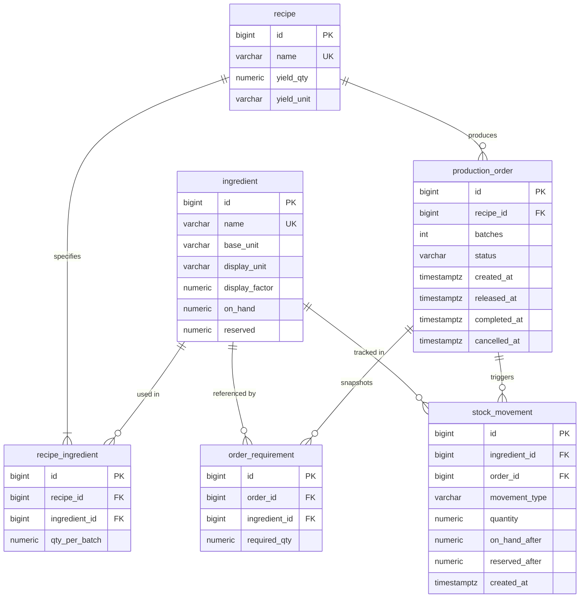

# Hearth Kitchen

Hearth Kitchen is a production-order and stock management system designed for central bakery and commissary kitchens.
It tracks recipe-driven ingredient consumption and reservations using an append-only audit ledger and deterministic pessimistic locking.

---

## Prerequisites

- **Java 17** (JDK 17 LTS)
- **Docker Desktop** (or Docker Engine with Docker Compose)

---

## How to Run

1. **Start the PostgreSQL 16 database container:**
   ```bash
   docker compose up -d
   ```
2. **Start the Spring Boot application:**
   ```bash
   ./mvnw spring-boot:run
   ```
3. **Open the application:**
   Navigate to [http://localhost:8080](http://localhost:8080) (automatically redirects to `/stock`).

### Reset to Fresh Seed Data
To purge the database and reapply Flyway migrations (`V1` schema + `V2` seed data):
```bash
docker compose down -v
docker compose up -d
./mvnw spring-boot:run
```

---

## Running Automated Tests

Run the full automated test suite (including unit tests, web MVC tests, and Testcontainers PostgreSQL integration tests):
```bash
./mvnw test
```
*(Docker must be running as Testcontainers will start a PostgreSQL 16 container for testing).*

---

## Manual API Testing (Postman)

A preconfigured Postman collection is included in the repository root:
- [`hearth-kitchen.postman_collection.json`](hearth-kitchen.postman_collection.json)

Import it into Postman to test all endpoints. Because the frontend is server-rendered Thymeleaf without JavaScript, requests send `application/x-www-form-urlencoded` form data and receive HTML responses following the Post-Redirect-Get (PRG) pattern.

---

## Data Model



### Design Decisions:
- **Base Units + Display Factor (`NUMERIC(14,3)`):** All stock calculations and database storage occur in base units (`g`, `ml`, `pcs`). Conversions to user-facing units (`kg`, `L`) use a positive `display_factor` (e.g. 1000). This eliminates floating-point drift and rounding inaccuracies.
- **`order_requirement` Snapshot:** When an order is released, required quantities are captured in `order_requirement`. If recipes change in the future, past order history and audit requirements remain intact.
- **Append-Only `stock_movement` Ledger:** Stock records are never mutated or deleted. Every state change creates a permanent movement (`RESERVE`, `UNRESERVE`, `CONSUME`) with running balances (`on_hand_after`, `reserved_after`) for full auditability.
- **Database CHECK Constraints:** Constraints like `CHECK (on_hand >= reserved)`, `CHECK (on_hand >= 0)`, and `CHECK (display_factor > 0)` enforce physical invariants at the database level regardless of application entry points.

---

## How Correctness is Guaranteed

1. **Single Transaction per Action (`@Transactional`):** All business operations (`createOrder`, `release`, `complete`, `cancel`) execute within a single atomic database transaction. If any validation fails (e.g., insufficient stock), the transaction rolls back cleanly with zero modified rows.
2. **Pessimistic Row Locking (`SELECT ... FOR UPDATE`):**
   - Eliminates race conditions where concurrent orders observe the same stock and double-reserve it.
3. **Strict Lock Ordering:**
   - **Step 1:** Lock the target order row via `productionOrderRepository.findByIdForUpdate(orderId)`.
   - **Step 2:** Lock required ingredients strictly in ascending `id` order via `ingredientRepository.findAllByIdForUpdate(sortedIds)`.
   - This strict linear ordering prevents circular wait conditions and mathematically eliminates deadlocks between concurrent release/complete/cancel transactions.
4. **Explicit State Transitions (`OrderStatus.canMoveTo`):**
   - `DRAFT` $\to$ `RELEASED` or `CANCELLED`
   - `RELEASED` $\to$ `COMPLETED` or `CANCELLED`
   - `COMPLETED` $\to$ terminal state
   - `CANCELLED` $\to$ terminal state

---

## Screens and URLs

| URL | Method | Purpose |
|---|---|---|
| `/` | `GET` | Redirects to `/stock` |
| `/stock` | `GET` | Central stock overview (On hand, Reserved, Available in display and base units) |
| `/stock/{id}` | `GET` | Ingredient details and chronological ledger movements (newest first) |
| `/orders` | `GET` | Filterable list of production orders + new order creation form |
| `/orders` | `POST` | Validates and creates a new order in `DRAFT` status |
| `/orders/{id}` | `GET` | Order detail view: timestamps, requirements, shortage box, movements, and actions |
| `/orders/{id}/release` | `POST` | Reserves inventory and transitions order to `RELEASED` |
| `/orders/{id}/complete` | `POST` | Deducts reserved and on-hand inventory, transitions order to `COMPLETED` |
| `/orders/{id}/cancel` | `POST` | Unreserves inventory (if released) and transitions order to `CANCELLED` |

---

## Demo Walkthrough

### Scenario 1: Shortage Rejection (Brioche loaf x 7)
1. Go to `/orders`.
2. Under "Create New Production Order", select **Brioche loaf** and enter **7** batches. Click **Create Order**.
3. You are redirected to `/orders/{id}`. The order status is `DRAFT`.
4. In the "Ingredient Requirements" table, notice that Butter (8400 g required vs 8000 g available) and Eggs (126 pcs required vs 120 pcs available) are highlighted in red.
5. Click **Release Order**.
6. The release is rejected! An alert box titled **"Release rejected – not enough stock"** appears, listing exactly the 2 missing ingredients and their shortfalls (Butter short by 400 g, Eggs short by 6 pcs).
7. Inspect `/stock`: no stock was reserved, and no movements were logged.

### Scenario 2: Successful Order Lifecycle (Brioche loaf x 4)
1. Go to `/orders` and create an order for **Brioche loaf** with **4** batches.
2. On `/orders/{id}`, click **Release Order**:
   - Stock is successfully reserved (Butter reserved increases by 4800 g to 4.8 kg, Eggs reserved increases by 72 pcs).
   - Order status moves to `RELEASED`.
   - 7 `RESERVE` movements are recorded in the movements table.
3. Click **Complete Order**:
   - Reserved stock is consumed (`onHand` decreases by 4800 g, `reserved` decreases by 4800 g).
   - Order status moves to `COMPLETED`.
   - 7 `CONSUME` movements are appended to the ledger.
4. Click on **Butter** in the requirements table to view `/stock/3`:
   - Current On hand is now `3.2 kg (3200 g)`, Reserved is `0 kg`.
   - The ledger displays the complete audit history of all movements.

---

## Known Limitations and Next Steps

See [BUILD_LOG.md](BUILD_LOG.md) for architectural trade-offs, decision log, known limitations, and prioritized next steps.
